# Hackrun Unicatólica - Edição: Capim Dourado Shopping 🚀

### Guia Acessível · Totem + Web App de acessibilidade · Grupo 18 ENTEI

<p align="center">
  <a href="https://franciscoars.github.io/Hackarun/"></a>
  <a href="https://franciscoars.github.io/Hackarun/?totem"></a>
  <a href="https://github.com/franciscoars/Hackarun/raw/main/simulador/Guia-Acessivel-Capim-Dourado.html"></a>
</p>

---

## ⚡ Acesso rápido

| Quero... | Como |
|---|---|
| **Usar no celular** | Aponte a câmera para o QR Code abaixo ou abra **[franciscoars.github.io/Hackarun](https://franciscoars.github.io/Hackarun/)**. Não precisa instalar nada. |
| **Ver o totem** (no PC) | Abra **[franciscoars.github.io/Hackarun/?totem](https://franciscoars.github.io/Hackarun/?totem)**. O QR Code na tela do totem abre o mesmo guia no celular. |
| **Rodar sem internet** | Baixe **[Guia-Acessivel-Capim-Dourado.html](https://github.com/franciscoars/Hackarun/raw/main/simulador/Guia-Acessivel-Capim-Dourado.html)** (12,7 MB) e dê dois cliques. Tudo vem dentro do arquivo. |
| **Ir direto para uma rota** | Adicione `?destino=` ao link. Ex.: [Praça de Alimentação](https://franciscoars.github.io/Hackarun/?destino=praca) · [Cinema](https://franciscoars.github.io/Hackarun/?destino=cinema) · [Banheiros](https://franciscoars.github.io/Hackarun/?destino=banh0) · [SAC](https://franciscoars.github.io/Hackarun/?destino=sac) |
| **Ler o código** | Pasta [`app/`](app/) (Flutter) ou tudo em um arquivo: [`app/CODIGO_COMPLETO.txt`](app/CODIGO_COMPLETO.txt). |

<p align="center">
  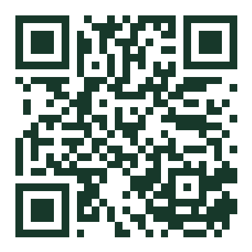<br>
  <em>Aponte a câmera do celular para abrir o Guia Acessível</em>
</p>

### 👆 Como usar (roteiro de demonstração)

1. **Boas-vindas:** toque em qualquer lugar para começar.
2. **Rotas:** escolha um destino (ex.: *Praça de Alimentação*). O mapa redondo mostra o caminho; toque em **Próximo** para seguir passo a passo. A bússola no topo gira e indica **FRENTE / ESQUERDA / DIREITA / ELEVADOR**.
3. **Ouvir:** lê o passo em voz alta. Ative o **Guia por Voz** no menu para ouvir tudo automaticamente.
4. **Alto Contraste:** **1 toque** = preto e amarelo. **2 toques seguidos** = **modo Halloween** 🎃 (preto e laranja, abóboras, morcegos e teias).
5. **Comunicação por Imagens (CAA):** toque num pictograma (ex.: *Banheiro*); o app fala a frase e mostra em tela cheia para o atendente.
6. **Ajuda / SOS:** chama um atendente até o totem; o chamado fica registrado.
7. **Painel da gestão do shopping** (fim do menu): destinos mais buscados e mapas de calor de uso.

---

## 🗂️ Organização do repositório

```text
Hackarun/
├── README.md                 ← este documento (planejamento + resultado)
├── app/                      ← código-fonte do app em Flutter (totem + web app + Android)
│   ├── lib/                  ← telas, mapa, rotas, voz, banco de dados
│   ├── test/                 ← testes automatizados das rotas
│   ├── docs/imagens/         ← capturas de tela
│   ├── esboco_totem/         ← esboço do totem físico (NBR 9050)
│   ├── ferramentas/          ← servidor do totem e gerador do HTML único
│   └── CODIGO_COMPLETO.txt   ← todo o código em um só arquivo
├── simulador/
│   └── Guia-Acessivel-Capim-Dourado.html   ← app inteiro em 1 arquivo (offline)
├── prototipos/
│   └── totem-html-v1.html    ← primeiro protótipo do totem (HTML puro)
└── imgs/                     ← imagens deste README
```

O site publicado no **GitHub Pages** fica no branch [`gh-pages`](https://github.com/franciscoars/Hackarun/tree/gh-pages) (versão compilada do `app/`).

---

## 📌 Planejamento Técnico Inicial - Primeira Entrega

**Grupo 18: ENTEI**
* **Mentoras:** Débora e Tamirys Virgulino
* **Componentes:** Francisco de Assis Rodrigues dos Santos, Pedro Henrique Ricardo, Pedro Henrique Mendonça Passos e Samuel Pereira Dias.

### Problema 01: Acessibilidade e comunicação universal
* **Contexto:** O shopping recebe visitantes com diferentes necessidades de comunicação, incluindo pessoas surdas, cegas, pessoas com deficiência e estrangeiros.
* **Problemática:** Nem todos conseguem acessar informações, compreender orientações ou se comunicar com os profissionais do shopping com a mesma facilidade e autonomia.
* **Objetivo:** Tornar a experiência no shopping mais acessível, inclusiva e independente das limitações de comunicação dos visitantes.

---

## 📖 Documentação Inicial do Projeto

### Desafio
O desafio consiste em resolver as barreiras de comunicação e navegação enfrentadas por visitantes de um shopping center que possuem diferentes necessidades (pessoas surdas, cegas, com outras deficiências e estrangeiros não fluentes no idioma local). A problemática central é a falta de autonomia e facilidade no acesso a informações e orientações. O objetivo do projeto é desenvolver uma solução que torne a experiência no shopping plenamente acessível, inclusiva e independente das limitações de comunicação.

### Público-Alvo e Dados
Para fundamentar a solução, levantamos a proporção do público que será diretamente beneficiado pelo projeto:
* **Brasil:** Segundo os dados mais recentes do Censo Demográfico do IBGE (2022), cerca de 8,9% da população brasileira (aproximadamente 18,6 milhões de pessoas) possui algum tipo de deficiência (visual, auditiva, motora ou mental/intelectual).
* **Tocantins e Palmas:** Acompanhando a média nacional, estima-se que em torno de 8% a 9% da população do Estado do Tocantins e da capital Palmas conviva com alguma deficiência. A deficiência visual é historicamente a mais reportada, seguida pela motora e auditiva.
* **Estrangeiros e Turismo:** Palmas é o principal portão de entrada para o ecoturismo do Jalapão e das Serras Gerais, atraindo um fluxo constante de turistas internacionais. Os idiomas mais comuns demandados por esse público são o Inglês (idioma universal do turismo) e o Espanhol (devido à proximidade com outros países da América do Sul e rotas de mochileiros).

### Local de Aplicação
O projeto será implementado no **Capim Dourado Shopping**, o principal centro de compras de Palmas. Com base na planta arquitetônica (área total de 38.800,50 m²), o shopping possui uma estrutura horizontal ampla dividida em dois pavimentos principais:
* **1º Pavimento (Térreo):** Concentra grandes lojas âncoras (C&A, Renner, Riachuelo, Marisa, Pernambucanas) e área de entretenimento como brinquedos e cinema (Cinemark), corredores longos e diversas saídas, o que exige um bom sistema de roteamento para evitar fadiga em pessoas com mobilidade reduzida.
* **2º Pavimento (Praça de Alimentação / Lazer):** Concentra a rede de fast-food (McDonald's, Spoleto, Divino Fogão, Subway). É uma zona de alto ruído, onde a comunicação visual e por libras se faz ainda mais necessária.

<p align="center">
  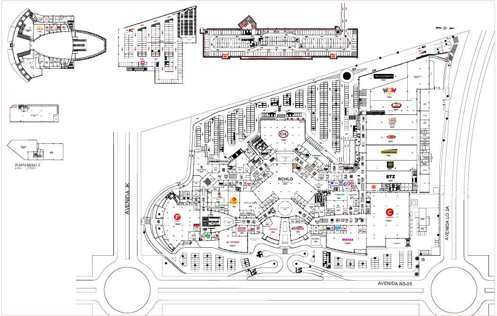<br>
  <em>Imagem 1 - Planta mix do Capim Dourado</em>
</p>

### Base Legal e Vantagens de Negócio
O projeto atende às diretrizes da **Lei Brasileira de Inclusão (LBI - Lei nº 13.146/2015)**, que garante o direito à acessibilidade em espaços de uso público, e segue as normas da **ABNT NBR 9050**.
Como vantagem competitiva na prática da Governança Ambiental, Social e Corporativa (ESG), além de evitar multas e litígios, tornar o ambiente acessível amplia a base de consumidores ativos (pessoas com deficiência e seus acompanhantes, além de turistas). Do ponto de vista de marketing, posiciona o Capim Dourado Shopping como boas práticas em ESG no Norte do país.

---

## 💡 A Solução Proposta

A solução consiste em um ecossistema físico-digital interativo, centrado em **Totens de Acessibilidade** instalados em pontos estratégicos do Capim Dourado Shopping (entradas, praça de alimentação e bifurcações principais), integrados a um **Web App via QR Code**.

### Funções do Totem
Ao se aproximar do totem, o visitante terá uma interface digital onde poderá:
* **Escolher seu idioma:** Adaptação instantânea de toda a interface para Português, Inglês ou Espanhol.
* **Ativar comandos de voz:** Navegação sem necessidade de toque.
* **Aumentar letras e contraste:** Modos de alto contraste (fundo escuro, letras amarelas/brancas) e fontes disléxicas ou em tamanho ampliado.
* **Utilizar comunicação por imagens (CAA):** Comunicação Aumentativa e Alternativa usando pictogramas para pessoas com deficiência intelectual ou autismo.
* **Solicitar ajuda humana:** Um botão de emergência / auxílio.
* **Consultar rotas acessíveis:** Roteamento interno no mapa (ex: traçar a rota do Térreo até o McDonald's usando apenas elevadores).

### Estrutura Física Complementar
Ao lado da tela do totem, haverá uma placa física contendo:
* **Instruções em Braille;**
* **QR Code em Alto Relevo:** Para que pessoas cegas ou com baixa visão possam tatear e escanear facilmente com seus smartphones;
* **Botão Físico de Assistência:** Ao ser pressionado, o totem emite um aviso vocalizado ("Seu pedido de ajuda foi registrado. Dentro de instantes, um colaborador do shopping irá auxiliá-lo"). Simultaneamente, o sistema dispara um alerta para o rádio/tablet da equipe de segurança mais próxima;

<p align="center">
  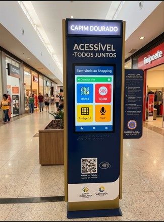<br>
  <em>Imagem 2 - Ilustração de expectativa gerada por IA do Totem</em>
</p>

### O Web Aplicativo (Zero-Install)
Ao escanear o QR Code, o dispositivo do visitante abre um Web App (sem necessidade de download).
* Ele espelha as funções do totem no celular do usuário (trazendo autonomia).
* **Comportamento Padrão:** O web app já carrega com a navegação vocalizada ativada (pensando no visitante cego que escaneou o QR Code tátil).
* **Controle do Usuário:** Para visitantes que não precisam do leitor de tela (como estrangeiros ou pessoas surdas), haverá um botão grande e visível na primeira tela para Desativar a Voz.

<p align="center">
  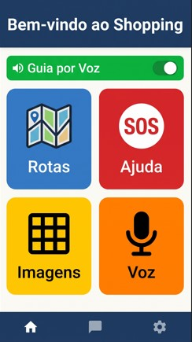<br>
  <em>Imagem 3 - Ilustração de expectativa gerada por IA do Web App</em>
</p>

---

## 📊 Análise de Mercado e Críticas a Soluções Semelhantes

Vantagens é que os Totens já são dispositivos de autoatendimento altamente validados e comuns no varejo e em praças de alimentação. Eles reduzem filas, diminuem a ansiedade do usuário e centralizam informações.

De acordo com publicações jurídicas e jornalísticas recentes (como a crítica à "Totemização do Atendimento" abordada pelo portal Migalhas em outubro de 2026), a proliferação desenfreada de totens de autoatendimento tradicionais tem gerado exclusão digital e discriminação indireta. As críticas apontam que os totens normais exigem letramento digital, visão perfeita e coordenação motora, além de criarem "ciclos sem saída" onde o cliente não consegue falar com um humano.

Nossa solução resolve exatamente a maior crítica da "totemização". Ao incluir comandos de voz, alto contraste, leitura em braille e, fundamentalmente, o **Botão Físico de Chamado Humano**, o projeto une o melhor da tecnologia (autonomia) com o acolhimento humano, garantindo que ninguém fique frustrado ou isolado diante da máquina.

---

## 🛠️ Planejamento Técnico e Arquitetura

### Proposta e Estrutura Inicial das Telas
O design seguirá princípios de acessibilidade universal:
* **Tela Inicial (Boas-Vindas):** Botões grandes de seleção de idioma (Bandeiras + Texto). Opções rápidas visíveis: "Alto Contraste", "Modo Voz".
* **Tela Principal (Menu):** Ícones grandes (Pictogramas). Opções: "Lojas", "Alimentação", "Banheiros", "Falar com Atendente".
* **Tela de Mapa (Roteamento):** Exibição da planta do Capim Dourado Shopping com a rota tracejada. Opção de "Rota Acessível" (evitando escadas).
* **Tela do Web App:** UI focada em mobile, replicando as funções com um pop-up imediato: "Acessibilidade por voz ativada. [Toque aqui para desativar]".

### Plataforma e Tecnologias Adotadas
* **Framework Principal:** Flutter (com linguagem Dart). O Flutter é um framework multiplataforma (cross-platform). Isso nos permite escrever o código apenas uma vez e compilá-lo tanto para rodar nativamente no Totem (Windows/Linux via Flutter Desktop) quanto para o celular do usuário final (via Flutter Web) acessado pelo QR Code.
* **Controle de Versão:** Git e GitHub para o versionamento e desenvolvimento colaborativo seguro da equipe.
* **Acessibilidade:** Web Speech API / flutter_tts para conversão de Texto para Voz (TTS) e widgets com atributos semânticos (Semantics).
* **Backend:** Firebase ou Supabase (BaaS) para gerenciamento em tempo real dos chamados de assistência e dados de mapeamento.

### Arquitetura Proposta
* **Frontend (Interface do Totem e Web App):** Desenvolvido em Flutter, consumindo bibliotecas nativas de text-to-speech (TTS) e speech-to-text (STT) para os comandos de voz.
* **Backend (Serviço de Alertas):** Firebase ou Supabase (BaaS) para gerenciar em tempo real os chamados de assistência (quando o botão físico é apertado, o backend notifica a equipe do shopping) e armazenar os dados de mapa e lojas.
* **Hardware (Totem):** Tela touch-screen, alto-falantes embutidos, microfone direcional para captura de voz e botão físico integrado via microcontrolador (ex: Arduino/ESP32) para comunicação com o sistema.

### Incorporação da Tecnologia
O uso do Flutter será central para a estruturação de todo o sistema visual e lógico. A prática de Single Codebase (código único) do Flutter garantirá que a experiência visual que o deficiente ou estrangeiro inicia no totem seja perfeitamente contínua ao escanear o QR Code, transferindo a sessão do totem para a palma da mão (Web App) sem perda de contexto ou atrasos de carregamento.

---

## 👥 Organização da Equipe e Metodologia de Trabalho

Para garantir a entrega contínua de valor e a rápida adaptação do protótipo durante o Hackrun, a equipe adotará a Metodologia Ágil, fundamentada em ciclos curtos de desenvolvimento (Sprints). Essa abordagem permite focar nas funcionalidades essenciais do MVP (produto mínimo viável) de forma incremental e organizada.

### Divisão de Papéis e Responsabilidades
* **Francisco (Product Owner):** Documentação, Pesquisa e Gestão Ágil. Responsável por manter o escopo alinhado, conduzir a pesquisa de dados oficiais e legislações (IBGE, LBI), estruturar a documentação técnica e formular a argumentação estratégica do projeto.
* **Pedro Henrique Ricardo (Frontend):** Desenvolvimento Mobile / Frontend (Flutter). Encarregado de codificar as telas no Flutter, implementar botões de grande escala, alternância de alto contraste e atributos semânticos de acessibilidade.
* **Samuel Pereira Dias (UX/UI):** Design e Foco em Acessibilidade. Desenvolvedor dos protótipos visuais, validação de contraste (WCAG AAA), ergonomia da solução (posicionamento do botão a 1,20m) e mapeamento da jornada do usuário.
* **Pedro Henrique M. Passos (Backend):** Desenvolvimento Backend e Integrações. Responsável por conectar o aplicativo às APIs de conversão de texto para voz (TTS) e estruturar a lógica de comunicação dos chamados de assistência.

### Matriz RACI de Responsabilidades
Para garantir a transparência das entregas, as responsabilidades foram mapeadas na matriz abaixo:

| Tarefa / Artefato | Francisco (PO / Ágil) | Pedro Henrique (Frontend) | Samuel (UX / UI) | Pedro Passos (Backend) |
| :--- | :---: | :---: | :---: | :---: |
| **Documentação Técnica e Pesquisa** | **R / A** | I | C | I |
| **Design, Prototipação e Acessibilidade** | C | C | **R / A** | I |
| **Desenvolvimento da Interface (Flutter)** | I | **R / A** | C | C |
| **Integração Backend e APIs (Voz/Alerta)** | I | C | I | **R / A** |

*(Legenda: **R** = Responsável pela execução; **A** = Aprovador final da tarefa; **C** = Consultado para apoio técnico; **I** = Informado do andamento).*

---

## 🏁 Considerações Finais

Este documento reflete o planejamento técnico inicial e o escopo do Produto Mínimo Viável (MVP) concebido pela equipe. A Matriz RACI apresentada detalha exclusivamente a organização interna da equipe para esta primeira fase de ideação, planejamento e prototipação rápida.

Nas próximas etapas do projeto, a matriz de responsabilidades será atualizada para incluir o Cliente (a administração do Shopping e os próprios usuários finais). Como estamos desenvolvendo a solução para eles, o cliente assumirá o papel de Aprovador Final das funcionalidades, garantindo que o produto entregue realmente atenda às necessidades do dia a dia do shopping.

Por adotarmos uma metodologia ágil, ressaltamos que a arquitetura e a interface propostas poderão sofrer alterações ao longo do processo. Essa flexibilidade é essencial para que o projeto se adapte rapidamente aos feedbacks da monitoria e às validações práticas que ocorrerão durante o desenvolvimento no Hackrun.

---
---

## 🚀 Resultado: MVP Funcional

A equipe materializou o planejamento técnico em um protótipo funcional multiplataforma em **Flutter**, acompanhado do esboço ergonômico do totem físico. **[Experimente agora →](https://franciscoars.github.io/Hackarun/)**

### Telas Implementadas

| Boas-vindas | Menu | Destinos | Modo Halloween |
|---|---|---|---|
| 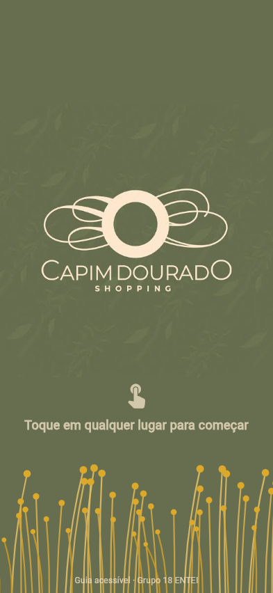 | 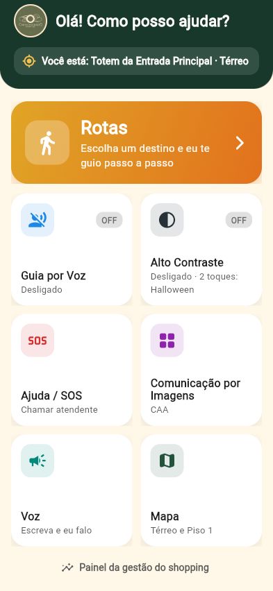 | 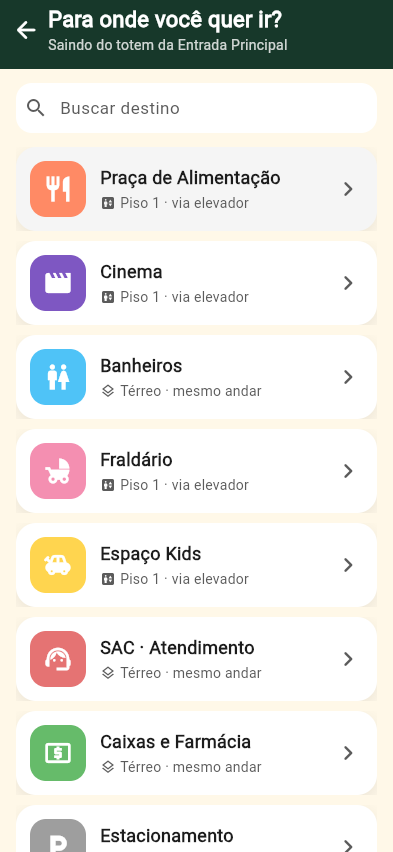 | 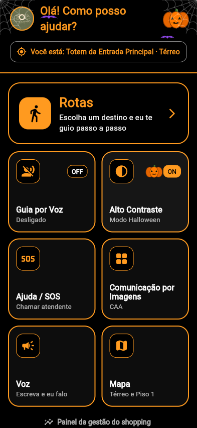 |

| Rota no Térreo (bússola) | Piso 1 pelo elevador | Chegada | Alto Contraste |
|---|---|---|---|
| 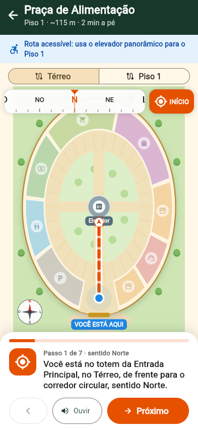 | 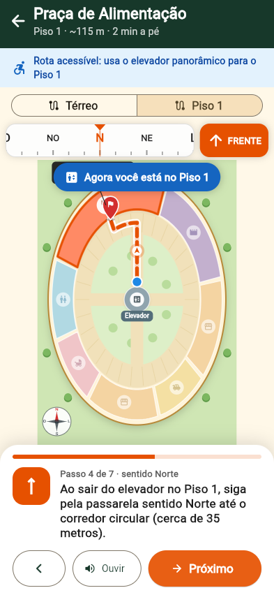 | 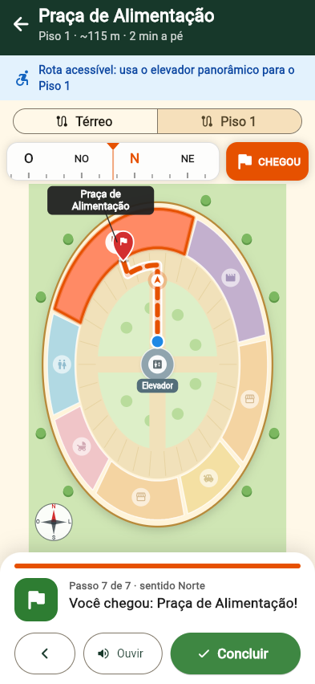 | 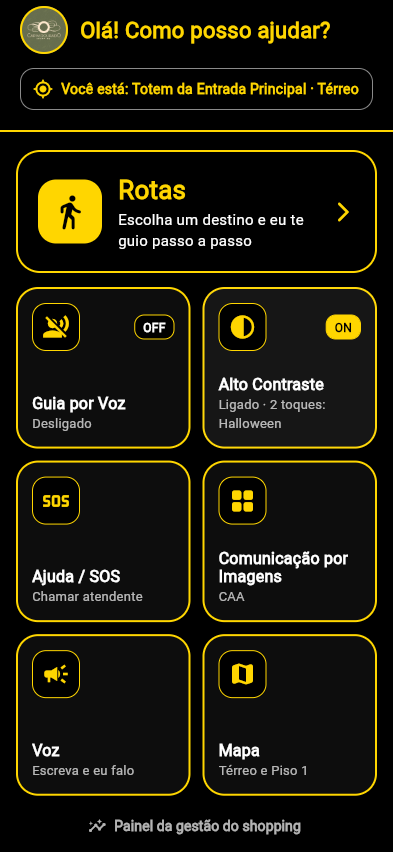 |

| Rota no modo Halloween | Painel da Gestão | SOS salvo no banco |
|---|---|---|
| 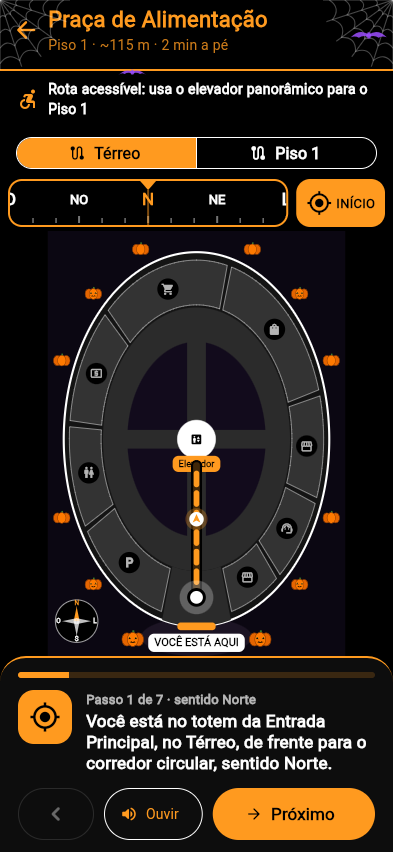 | 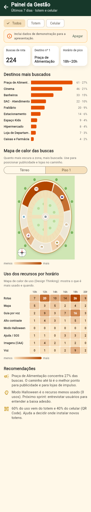 | 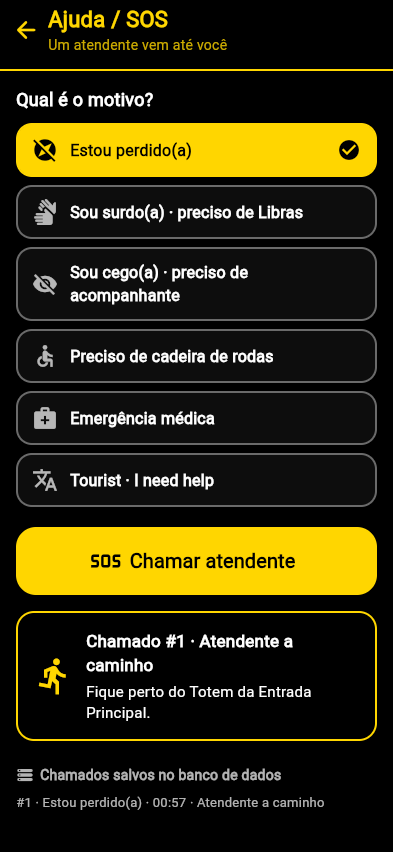 |

| Totem: menu | Totem: rota + QR Code |
|---|---|
| 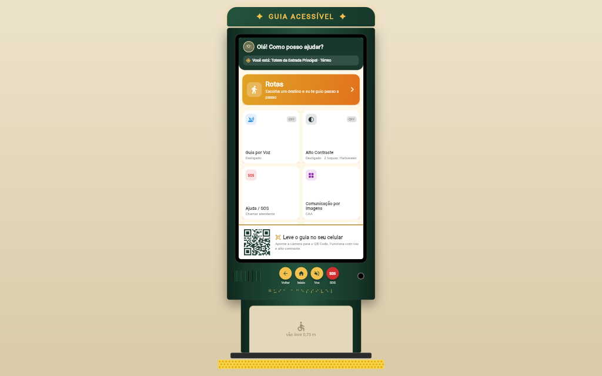 | 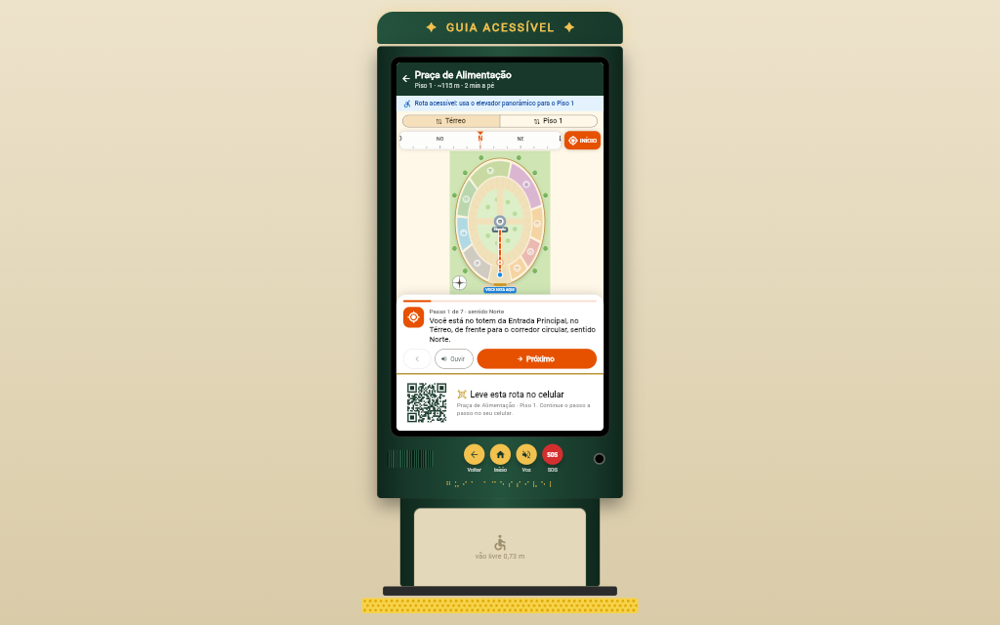 |

### Funcionalidades Entregues

| Recurso | O que faz |
|---|---|
| **Tela de boas-vindas** | Logo oficial do shopping e "Toque em qualquer lugar para começar", com capim dourado animado. |
| **Mapa redondo (MVP de locais fixos)** | Prédio oval com corredor circular, jardim no átrio, passarelas nos 4 pontos cardeais e elevador panorâmico no centro. As zonas são setores fixos do anel nos dois pisos *(layout ilustrativo criado para o protótipo)*. |
| **Rotas por zona** | O visitante escolhe uma área (ex.: Praça de Alimentação). O mapa nomeia **só a zona de destino** e traça a rota seguindo a curva do corredor a partir do "Você está aqui". |
| **Bússola / HUD de orientação** | Faixa de bússola no estilo de jogo (N, NE, L, SE...) que gira com o rumo de cada passo, mais um selo com a direção: FRENTE, ESQUERDA, DIREITA, ELEVADOR, CHEGOU. A voz fala a mesma coisa ("À esquerda... sentido Norte"). |
| **Passo a passo** | Instruções com direção real (esquerda/direita), sentido cardeal, distância em metros, troca automática de piso e aviso de elevador. |
| **Guia por Voz** | Lê telas e rotas em voz alta (Text-to-Speech). |
| **Alto Contraste** | 1 toque: tema preto e amarelo em todo o app, incluindo o mapa (WCAG AAA). |
| **Modo Halloween** | 2 toques seguidos no Alto Contraste: preto e laranja (também acima de 7:1), com abóboras, morcegos, teias e a aranha que desce na tela de boas-vindas. |
| **Ajuda / SOS** | Chama um atendente até o totem; o chamado fica salvo no banco com status. |
| **Comunicação por Imagens (CAA)** | Pictogramas que falam a frase e mostram em tela cheia para o atendente. |
| **Voz** | Digite e o app fala, em português, inglês ou espanhol. |
| **Painel da Gestão** | Relatório para o shopping: destinos mais buscados (onde colocar publicidade e lojas), mapa de calor das buscas por zona e mapa de calor de uso dos recursos por horário (Design Thinking), com filtro totem/celular. Vem com dados de demonstração, que podem ser apagados. |
| **Modo Totem** | Emulação do totem físico com QR Code real (leva a rota para o celular), botões físicos e reinício após 90 s sem uso. |

### Arquitetura e Estrutura do Código (`app/lib/`)

- **Flutter** (código único): Web Mobile (QR Code), Totem e Android.
- **Banco de dados local Sembast** (NoSQL): IndexedDB no navegador e arquivo no Android.
  - `zonas`: áreas do mapa dos 2 pavimentos
  - `chamados_sos`: chamados de assistência e status
  - `eventos`: uso anônimo (rotas buscadas, recursos usados, origem totem/celular) para o Painel da Gestão
  - `preferencias`: alto contraste, Halloween e guia por voz
- **`flutter_tts`**: voz (Web Speech API no navegador).
- **`qr_flutter`**: QR Code do totem, que carrega a rota escolhida (`?destino=praca`).
- Acessibilidade com `Semantics` (rótulos, regiões ao vivo, estados de botões).

```text
app/lib/
├── main.dart                 # Inicialização, banco e escolha celular/totem
├── config.dart               # Modo totem, link do QR, rota atual
├── app_state.dart            # Estado global, preferências e voz (TTS)
├── theme.dart                # Cores do shopping, alto contraste e Halloween
├── data/                     # Banco Sembast, modelos, geometria oval e dados do mapa
├── logic/rota.dart           # Cálculo da rota e instruções passo a passo
├── screens/                  # Boas-vindas, menu, rotas, mapa, SOS, CAA, voz, painel da gestão
└── widgets/                  # Mapa redondo, bússola/HUD, Halloween, moldura do celular e do totem
```

### Como rodar o código

Pré-requisito: [Flutter](https://docs.flutter.dev/get-started/install) 3.47 ou mais novo.

```bash
cd app
flutter pub get

flutter run -d chrome                                       # celular (moldura no navegador)
powershell -ExecutionPolicy Bypass -File rodar_totem.ps1    # totem na rede local
flutter run -d android                                      # Android
flutter test                                                # testes das rotas
```

Mais detalhes (como gerar o simulador HTML, publicar etc.) em [`app/README.md`](app/README.md).

---

## 📚 Referências

* **BRASIL.** Lei nº 13.146, de 6 de julho de 2015. Institui a Lei Brasileira de Inclusão da Pessoa com Deficiência (Estatuto da Pessoa com Deficiência). Diário Oficial da União, Brasília, DF, 7 jul. 2015. Disponível em: [http://www.planalto.gov.br/ccivil_03/_ato2015-2018/2015/lei/l13146.htm](http://www.planalto.gov.br/ccivil_03/_ato2015-2018/2015/lei/l13146.htm). Acesso em: 13 nov. 2026.
* **GOOGLE.** Gemini. Mountain View, CA: Google, 2026. Inteligência artificial generativa (Modelo Multimodal). Utilizado para auxílio na estruturação documental, ideação de protótipos de tela, geração de código base em Flutter e criação de imagens conceituais do projeto. Disponível em: [https://gemini.google.com](https://gemini.google.com). Acesso em: 13 nov. 2026.
* **OPENAI.** ChatGPT. San Francisco, CA: OpenAI, 2026. Inteligência artificial generativa (Modelo de Linguagem). Utilizado pela equipe para apoio na ideação e estruturação inicial da proposta do projeto. Disponível em: [https://chatgpt.com](https://chatgpt.com). Acesso em: 13 nov. 2026.
* **ANTHROPIC.** Claude (Claude Code). San Francisco, CA: Anthropic, 2026. Inteligência artificial generativa (Modelo de Linguagem). Utilizado no desenvolvimento do código Flutter, nos testes e na publicação do protótipo. Disponível em: [https://claude.com](https://claude.com). Acesso em: 14 nov. 2026.
* **INSTITUTO BRASILEIRO DE GEOGRAFIA E ESTATÍSTICA (IBGE).** Pesquisa Nacional por Amostra de Domicílios Contínua (PNADC) 2022: Pessoas com deficiência e as desigualdades sociais no Brasil. Rio de Janeiro: IBGE, 2023. Disponível em: [https://ibge.gov.br](https://ibge.gov.br). Acesso em: 13 nov. 2026.
* **MINISTÉRIO DO TURISMO.** Anuário Estatístico de Turismo. Brasília, DF: Ministério do Turismo, 2025. Disponível em: [https://www.gov.br/turismo](https://www.gov.br/turismo). Acesso em: 13 nov. 2026.
* **SOUL MALLS; CAPIM DOURADO SHOPPING.** Operações - Capim Dourado Shopping: Plantas Baixas (Pavimento Térreo e Praça de Alimentação). Palmas, TO, nov. 2026. Arquivo PDF.
* **TOCANTINS.** Secretaria de Estado do Turismo (SETUR). Observatório do Turismo do Tocantins: perfil da demanda turística. Palmas: SETUR, 2025. Disponível em: [https://www.to.gov.br/turismo](https://www.to.gov.br/turismo). Acesso em: 13 nov. 2026.
* **W3C - WORLD WIDE WEB CONSORTIUM.** Web Content Accessibility Guidelines (WCAG) 2.2. 11 out. 2023. Disponível em: [https://www.w3.org/TR/WCAG22/](https://www.w3.org/TR/WCAG22/). Acesso em: 13 nov. 2026.
