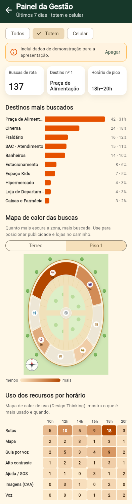

# Caminhos mais usados no totem

Rotas mais buscadas a partir do **Totem da Entrada Principal (Térreo)**, segundo o **Painel da Gestão** do app (filtro *Totem*), e o passo a passo exato que o guia mostra e fala em cada uma.

> ⚠️ **Dados de demonstração.** Os números abaixo vêm dos acessos de exemplo que o app cria para a apresentação (filtro *Totem*: 137 buscas em 7 dias). Com o totem em uso, o Painel da Gestão mostra os números reais, e os dados de exemplo podem ser apagados no botão **Apagar**.

## Ranking

| # | Destino | Buscas no totem | % | Piso | Caminho | Distância |
|:-:|---|:-:|:-:|---|---|:-:|
| 1 | [Praça de Alimentação](#1-praça-de-alimentação) | 42 | 31% | Piso 1 | Elevador panorâmico → passarela **Norte** | ~115 m |
| 2 | [Cinema](#2-cinema) | 24 | 18% | Piso 1 | Elevador panorâmico → passarela **Leste** | ~120 m |
| 3 | [Fraldário](#3-fraldário) | 16 | 12% | Piso 1 | Elevador panorâmico → passarela **Oeste** | ~120 m |
| 4 | [SAC · Atendimento](#4-sac--atendimento) | 15 | 11% | Térreo | Corredor circular pela **direita** | ~60 m |
| 5 | [Banheiros](#5-banheiros) | 14 | 10% | Térreo | Corredor circular pela **esquerda** | ~80 m |
| 6 | Estacionamento | 8 | 6% | Térreo | Corredor circular pela esquerda | ~50 m |
| 7 | Espaço Kids | 7 | 5% | Piso 1 | Elevador panorâmico → passarela Sul | ~120 m |
| 8 | Hipermercado | 4 | 3% | Térreo | Corredor circular pela esquerda | ~150 m |
| 9 | Loja de Departamento | 4 | 3% | Térreo | Corredor circular pela direita | ~125 m |
| 10 | Caixas e Farmácia | 3 | 2% | Térreo | Corredor circular pela esquerda | ~110 m |

## O que os caminhos mostram

- **O trecho mais percorrido é a passarela da entrada até o elevador panorâmico.** 4 dos 7 destinos mais buscados ficam no Piso 1, e 65% das buscas do totem (89 de 137) passam pelo elevador. É o melhor ponto para publicidade, sinalização e lojas de impulso.
- **No Piso 1, a saída Norte do elevador é a mais usada** (Praça de Alimentação, 31% sozinha).
- **No Térreo, a curva à direita leva ao SAC** e a curva à esquerda leva a Banheiros, Estacionamento e Caixas. Sinalização tátil e em braille nessas duas bifurcações atende a maior parte das rotas do térreo.
- **Elevador acessível em todas as rotas do Piso 1.** O guia nunca manda o visitante por escada.

## Passo a passo dos 5 caminhos mais usados

Texto exato que aparece na tela e é falado pelo **Guia por Voz**. A bússola no topo do mapa mostra o mesmo sentido (N, NE, L...) e o selo **FRENTE / ESQUERDA / DIREITA / ELEVADOR / CHEGOU**.

### 1. Praça de Alimentação
Piso 1 · ~115 m · 7 passos · [abrir esta rota](https://franciscoars.github.io/Hackarun/?destino=praca)

1. **[Térreo]** Você está no totem da Entrada Principal, no Térreo, de frente para o corredor circular, sentido Norte.
2. **[Térreo]** Siga em frente, sentido Norte, atravesse o corredor circular e continue pela passarela até o elevador panorâmico, no centro (cerca de 55 metros).
3. **[Térreo]** Pegue o elevador acessível e suba para o Piso 1.
4. **[Piso 1]** Ao sair do elevador no Piso 1, siga pela passarela sentido Norte até o corredor circular (cerca de 35 metros).
5. **[Piso 1]** Vire à esquerda, sentido Oeste, e acompanhe a curva do corredor por cerca de 15 metros.
6. **[Piso 1]** Praça de Alimentação fica à sua direita, sentido Norte.
7. **[Piso 1]** Você chegou: Praça de Alimentação!

### 2. Cinema
Piso 1 · ~120 m · 7 passos · [abrir esta rota](https://franciscoars.github.io/Hackarun/?destino=cinema)

1. **[Térreo]** Você está no totem da Entrada Principal, no Térreo, de frente para o corredor circular, sentido Norte.
2. **[Térreo]** Siga em frente, sentido Norte, atravesse o corredor circular e continue pela passarela até o elevador panorâmico, no centro (cerca de 55 metros).
3. **[Térreo]** Pegue o elevador acessível e suba para o Piso 1.
4. **[Piso 1]** Ao sair do elevador no Piso 1, siga pela passarela sentido Leste até o corredor circular (cerca de 25 metros).
5. **[Piso 1]** Vire à esquerda, sentido Norte, e acompanhe a curva do corredor por cerca de 35 metros.
6. **[Piso 1]** Cinema fica à sua direita, sentido Nordeste.
7. **[Piso 1]** Você chegou: Cinema!

### 3. Fraldário
Piso 1 · ~120 m · 7 passos · [abrir esta rota](https://franciscoars.github.io/Hackarun/?destino=fralda)

1. **[Térreo]** Você está no totem da Entrada Principal, no Térreo, de frente para o corredor circular, sentido Norte.
2. **[Térreo]** Siga em frente, sentido Norte, atravesse o corredor circular e continue pela passarela até o elevador panorâmico, no centro (cerca de 55 metros).
3. **[Térreo]** Pegue o elevador acessível e suba para o Piso 1.
4. **[Piso 1]** Ao sair do elevador no Piso 1, siga pela passarela sentido Oeste até o corredor circular (cerca de 25 metros).
5. **[Piso 1]** Vire à esquerda, sentido Sul, e acompanhe a curva do corredor por cerca de 30 metros.
6. **[Piso 1]** Fraldário fica à sua direita, sentido Sudoeste.
7. **[Piso 1]** Você chegou: Fraldário!

### 4. SAC · Atendimento
Térreo · ~60 m · 5 passos · [abrir esta rota](https://franciscoars.github.io/Hackarun/?destino=sac)

1. **[Térreo]** Você está no totem da Entrada Principal, no Térreo, de frente para o corredor circular, sentido Norte.
2. **[Térreo]** Siga em frente, sentido Norte, por cerca de 20 metros até o corredor circular.
3. **[Térreo]** Vire à direita, sentido Leste, e acompanhe a curva do corredor por cerca de 35 metros.
4. **[Térreo]** SAC · Atendimento fica à sua direita, sentido Sudeste. Vire à direita para entrar.
5. **[Térreo]** Você chegou: SAC · Atendimento!

### 5. Banheiros
Térreo · ~80 m · 5 passos · [abrir esta rota](https://franciscoars.github.io/Hackarun/?destino=banh0)

1. **[Térreo]** Você está no totem da Entrada Principal, no Térreo, de frente para o corredor circular, sentido Norte.
2. **[Térreo]** Siga em frente, sentido Norte, por cerca de 20 metros até o corredor circular.
3. **[Térreo]** Vire à esquerda, sentido Oeste, e acompanhe a curva do corredor por cerca de 55 metros.
4. **[Térreo]** Banheiros fica à sua esquerda, sentido Oeste. Vire à esquerda para entrar.
5. **[Térreo]** Você chegou: Banheiros!

## Demais destinos (resumo)

| Destino | Passos principais |
|---|---|
| Estacionamento | Siga em frente ~20 m → vire à **esquerda** (Oeste) e siga a curva ~25 m → fica à esquerda (Sudoeste). |
| Espaço Kids | Passarela até o elevador ~55 m → suba ao Piso 1 → passarela **Sul** ~35 m → vire à esquerda (Leste) ~20 m → fica à direita (Sudeste). |
| Hipermercado | Siga em frente ~20 m → vire à **esquerda** (Oeste) e siga a curva ~120 m → fica à esquerda (Norte). |
| Loja de Departamento | Siga em frente ~20 m → vire à **direita** (Leste) e siga a curva ~100 m → fica à direita (Nordeste). |
| Caixas e Farmácia | Siga em frente ~20 m → vire à **esquerda** (Oeste) e siga a curva ~85 m → fica à esquerda (Noroeste). |

---

*Os passos são gerados pelo código em `lib/logic/rota.dart` (mapa em `lib/data/seed.dart`). O layout do mapa é ilustrativo, criado para o protótipo.*
