# Capim Dourado Shopping · Guia Acessível

Ecossistema de **totens de acessibilidade + Web App** para o Capim Dourado Shopping (Palmas/TO), criado pelo **Grupo 18 ENTEI** no **1º Hackrun UniCatólica**.

O visitante usa o totem ou lê o QR Code e o guia abre no próprio celular: rotas passo a passo nos dois pisos, guia por voz, alto contraste, comunicação por imagens e chamada de assistência (SOS).

## Telas

| Boas-vindas | Menu | Destinos | Modo Halloween |
|---|---|---|---|
| 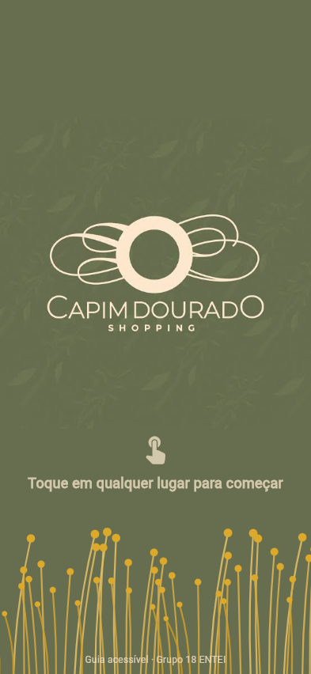 | 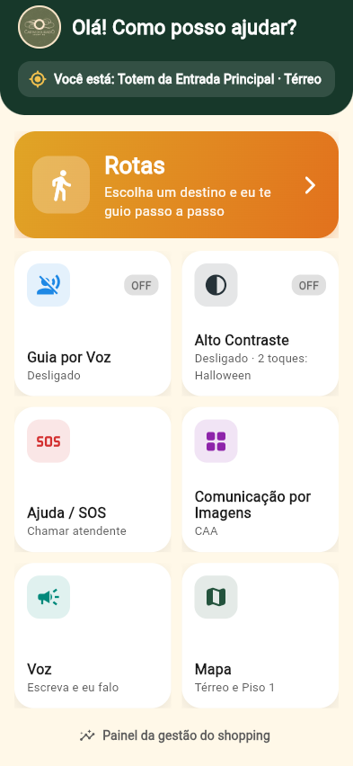 | 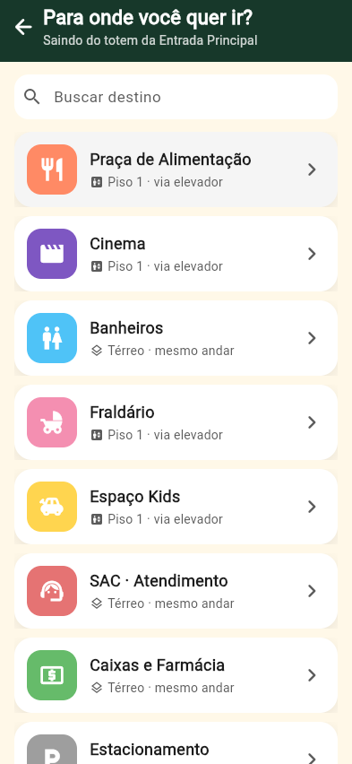 | 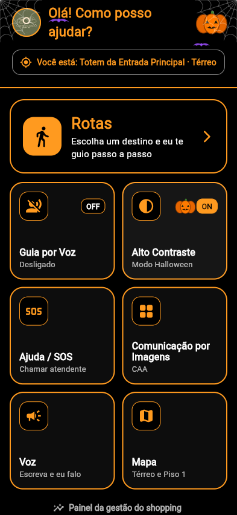 |

| Rota no Térreo (HUD + bússola) | Piso 1 pelo elevador | Chegada | Alto Contraste |
|---|---|---|---|
| 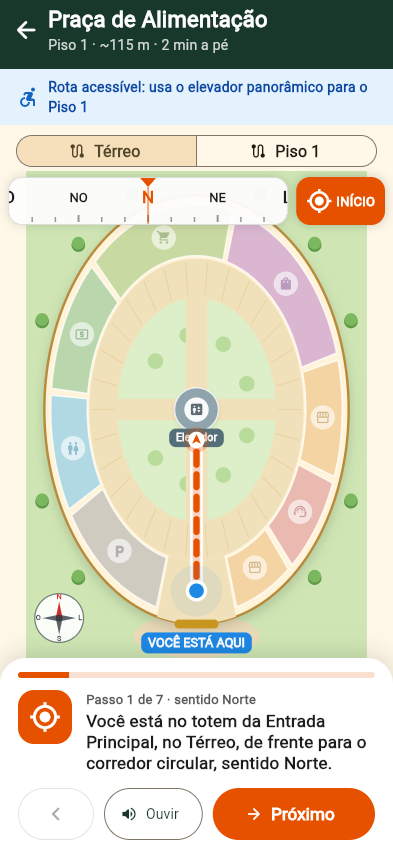 | 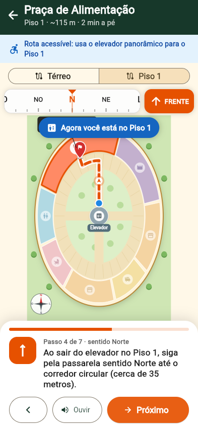 | 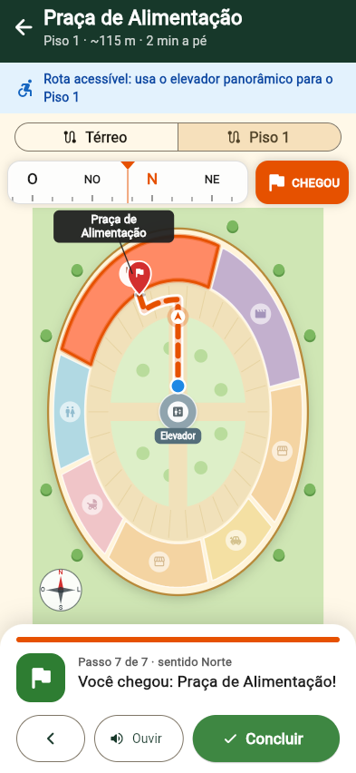 | 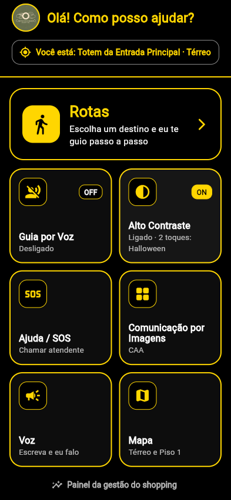 |

| Rota no modo Halloween | Painel da Gestão | SOS salvo no banco |
|---|---|---|
| 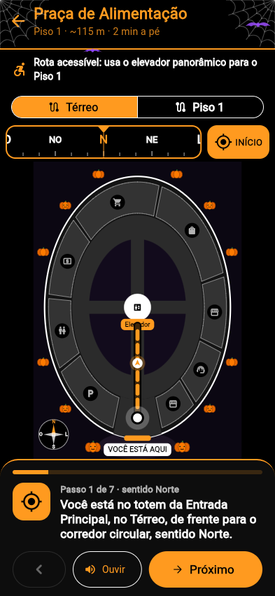 | 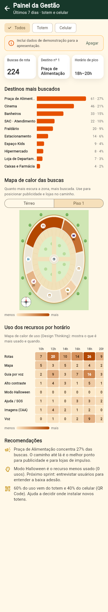 | 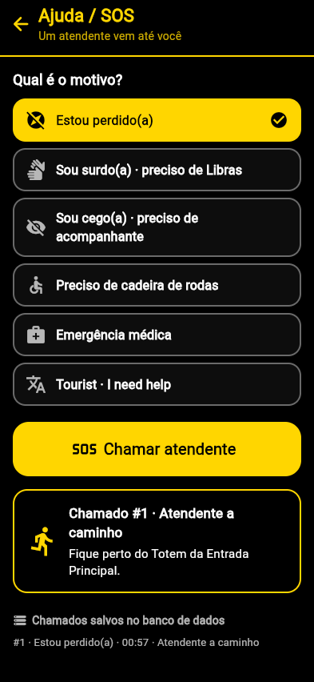 |

| Totem: menu | Totem: rota + QR Code |
|---|---|
| 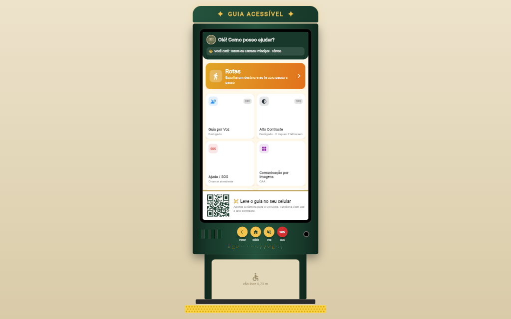 | 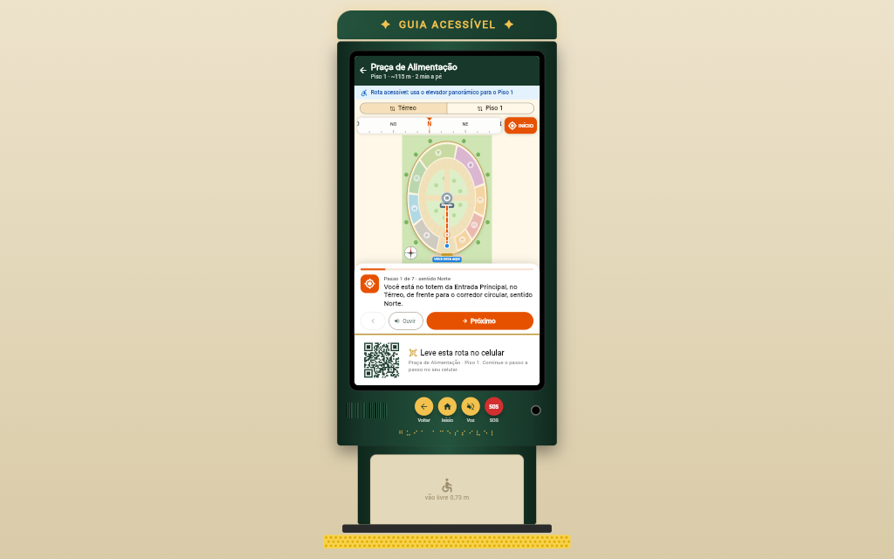 |

## Problema

Pessoas surdas, cegas, com deficiência física ou intelectual e turistas estrangeiros enfrentam barreiras para se localizar e se comunicar dentro do shopping (38.800 m², 2 pavimentos). O projeto segue a **LBI (Lei nº 13.146/2015)**, a **ABNT NBR 9050** e as diretrizes **WCAG**.

## Funcionalidades

| Recurso | O que faz |
|---|---|
| **Tela de boas-vindas** | Logo oficial do shopping e "Toque em qualquer lugar para começar", com capim dourado animado. |
| **Mapa redondo (MVP de locais fixos)** | O prédio é oval, com corredor circular, jardim no átrio, passarelas nos 4 pontos cardeais e elevador panorâmico no centro. As zonas são setores fixos do anel nos dois pisos. |
| **Rotas por zona** | O visitante escolhe uma área (ex.: Praça de Alimentação). O mapa nomeia **só a zona de destino** e traça a rota seguindo a curva do corredor a partir do "Você está aqui". |
| **Bússola / HUD de orientação** | Faixa de bússola no estilo de jogo (N, NE, L, SE...) que gira com o rumo de cada passo, mais um selo com a direção: FRENTE, ESQUERDA, DIREITA, ELEVADOR, CHEGOU. A voz fala a mesma coisa ("À esquerda. ... sentido Norte"). |
| **Passo a passo** | Instruções com direção real (esquerda/direita), sentido cardeal, distância em metros, troca automática de piso e aviso de elevador. |
| **Mapa ilustrado** | Térreo e Piso 1 em estilo lúdico, com zoom e toque nas áreas. |
| **Guia por Voz** | Lê telas e rotas em voz alta (Text-to-Speech). |
| **Alto Contraste** | 1 toque: tema preto e amarelo em todo o app, incluindo o mapa. |
| **Modo Halloween** | 2 toques seguidos no botão Alto Contraste: preto e laranja (também acima de 7:1), com abóboras, morcegos, teias e a aranha que desce na tela de boas-vindas. |
| **Ajuda / SOS** | Chama um atendente até o totem; o chamado fica salvo no banco com status. |
| **Comunicação por Imagens (CAA)** | Pictogramas que falam a frase e mostram em tela cheia para o atendente. |
| **Voz** | Digite e o app fala, em português, inglês ou espanhol. |
| **Painel da Gestão** | Relatório para o shopping: destinos mais buscados (onde colocar publicidade e lojas), mapa de calor das buscas por zona e mapa de calor de uso dos recursos por horário (Design Thinking), com filtro totem/celular. Vem com dados de demonstração, que podem ser apagados. |
| **Modo Totem** | Emulação do totem físico com QR Code real, botões físicos e reinício após 90 s sem uso. |

## Arquitetura

- **Flutter** (código único): Web Mobile (QR Code), Totem e Android.
- **Banco de dados local Sembast** (NoSQL): IndexedDB no navegador e arquivo no Android.
  - `zonas`: áreas do mapa dos 2 pavimentos
  - `chamados_sos`: chamados de assistência e status
  - `eventos`: uso anônimo (rotas buscadas, recursos usados, origem totem/celular) para o Painel da Gestão
  - `preferencias`: alto contraste, Halloween e guia por voz
- **flutter_tts**: voz (Web Speech API no navegador).
- **qr_flutter**: QR Code do totem, que carrega a rota escolhida (`?destino=praca`).
- Acessibilidade com `Semantics` (rótulos, regiões ao vivo, estados de botões).

```
lib/
├── main.dart                 # Inicialização, banco e escolha celular/totem
├── config.dart               # Modo totem, link do QR, rota atual
├── app_state.dart            # Estado global, preferências e voz (TTS)
├── theme.dart                # Cores do shopping e alto contraste
├── data/                     # Banco Sembast, modelos, geometria oval e dados do mapa
├── logic/rota.dart           # Cálculo da rota e instruções passo a passo
├── screens/                  # Boas-vindas, menu, rotas, mapa, SOS, CAA, voz, painel da gestão
└── widgets/                  # Mapa redondo, HUD/bússola, Halloween, moldura do celular e do totem
```

## Como rodar

Pré-requisito: [Flutter](https://docs.flutter.dev/get-started/install) 3.47 ou mais novo.

```bash
flutter pub get

# Celular (moldura de smartphone no navegador)
flutter run -d chrome

# Totem (compila, sobe servidor na rede local e abre o totem)
powershell -ExecutionPolicy Bypass -File rodar_totem.ps1

# Android (emulador ou aparelho)
flutter run -d android

# Testes
flutter test
```

No modo totem, o celular precisa estar no **mesmo Wi-Fi** do PC para abrir o QR Code.

### Logo oficial

A logo oficial do Capim Dourado Shopping fica em `assets/images/logo.jpg` (tela de boas-vindas e cabeçalho).

## Código completo em um arquivo

`CODIGO_COMPLETO.txt` reúne todas as linhas de código do projeto num único arquivo, com índice e contagem de linhas, para leitura e avaliação.

## Totem físico (esboço)

`esboco_totem/totem.html` mostra o conceito do equipamento: tela touch vertical entre 0,90 m e 1,20 m (alcance de cadeirante, NBR 9050), QR Code dinâmico, teclado com relevo e braille, alto-falante e fone, botão SOS, vão livre de 0,73 m e piso tátil de alerta.

## Equipe · Grupo 18 ENTEI

| Integrante | Papel |
|---|---|
| Francisco | Gestão Ágil / Product Owner |
| Pedro Henrique | Desenvolvimento Mobile / Frontend Flutter |
| Samuel | UX/UI Design, Acessibilidade WCAG AAA e ergonomia |
| Pedro Henrique M. Passos | Backend e Integrações de TTS/Alertas |

---

O mapa usa um layout ilustrativo dos dois pavimentos, criado para o protótipo.
